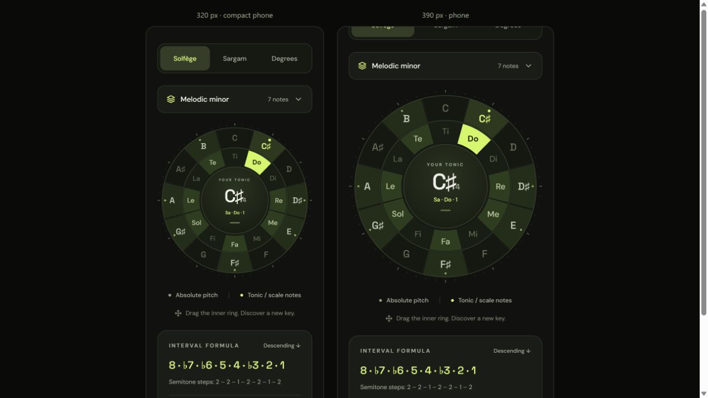
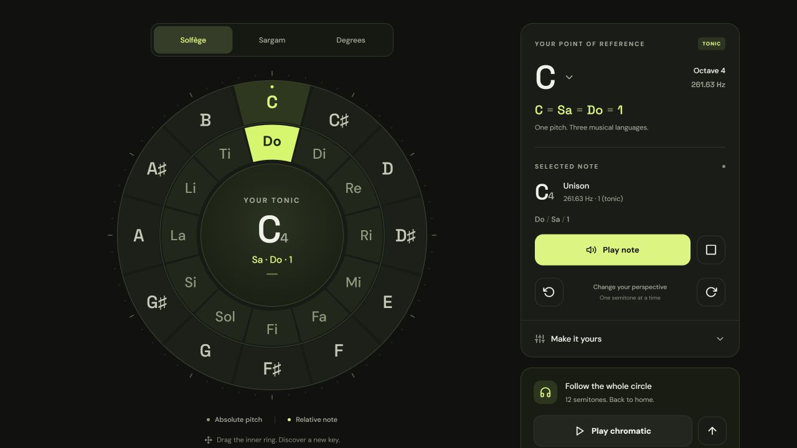
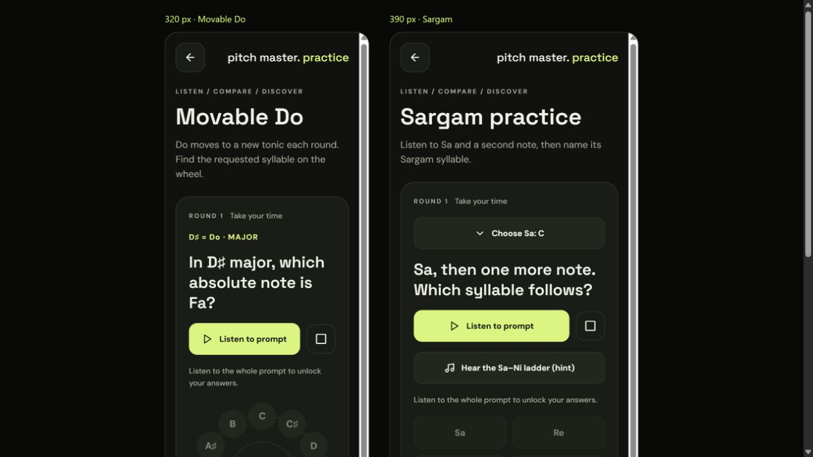
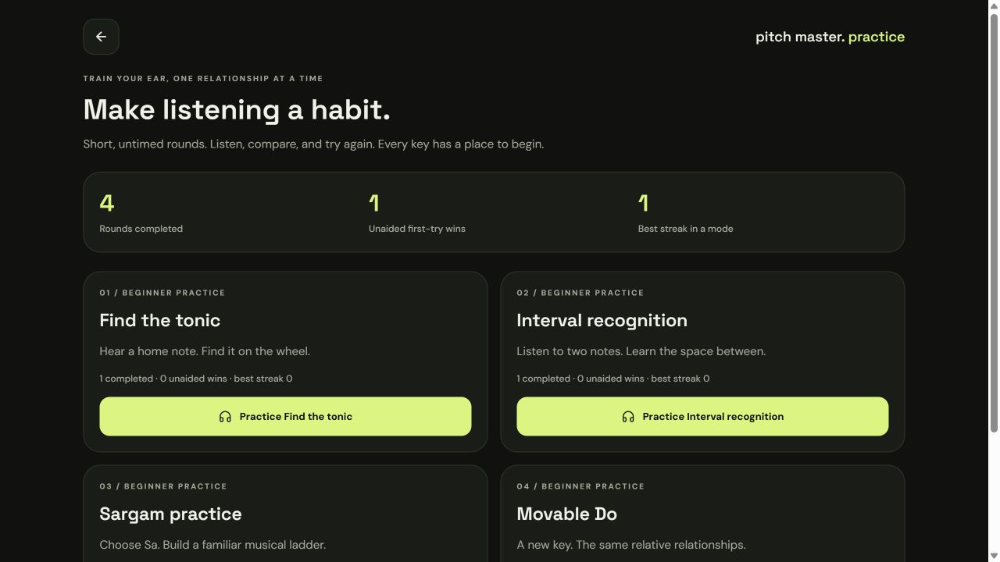
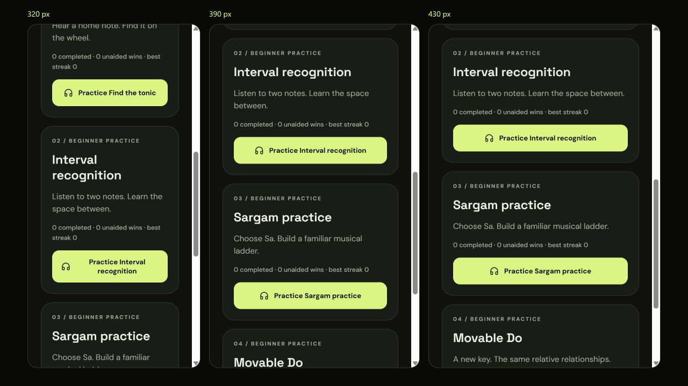

# Verification

## Automated checks

- Expo ESLint, including React Hooks rules: passed without warnings.
- Strict TypeScript, including unchecked array access: passed.
- 62 Node tests: passed, including all scales in every key/direction, drone synthesis/lifecycle, and practice question/grading/progress rules.
- Expo dependency compatibility check: passed.
- Expo Doctor: all 20 checks passed, including native peer dependencies and config plugins.
- Production browser export: passed.
- Android and iOS Hermes exports: passed. These validate bundling and bytecode compilation; they are not installed native binaries.

Windows sandbox permissions initially prevented Hermes from writing bytecode in the system temporary directory. Export succeeded using a directory inside the workspace:

```powershell
New-Item -ItemType Directory -Force .build-tmp | Out-Null
$env:TEMP = Join-Path (Get-Location) '.build-tmp'
$env:TMP = $env:TEMP
npx expo export --platform android --platform ios --output-dir dist-native --max-workers 2
```

## Browser checks

The running app was inspected in the in-app browser, including 320 px and 390 px layouts. Checked notation changes, button and drag rotation, outer-note tonic selection, inner-note playback without changing the key, flat spellings, octave changes, frequency and relationship updates, preference restoration after reload, chromatic playback progress, and Stop. Browser preview audio is real Expo Audio playback, not a mock. A visual preview cannot establish native audio latency or native frame rate.

Phase 2 checks cover the nine-scale picker, melodic minor's ascending/descending formulas and notation, scale playback starting at the upper tonic when descending, a drone remaining active across loop boundaries and melody playback, retuning from C4 to C♯4, and Stop all audio. No browser runtime warnings or errors appeared during these checks.

The 320 px and 390 px layouts show scale highlights and formulas without horizontal clipping. Reloading restored the chosen C♯ tonic, melodic minor scale, and descending direction, with the drone off. Stopping an active scale left the drone running as intended.





### Phase 3 practice

Browser checks covered all four modes: neutral tonic answers with reference C; six-interval and thirteen-interval choices; choosing G as Sa and playing the guided ladder; and movable Do questions with different tonics. The 320 px movable Do and 390 px Sargam layouts were inspected, including scrolling to answers, hints, and progress.

Answers remained disabled before a complete prompt and after an early Stop. Wrong attempts gave immediate feedback and disabled only that choice. Hints marked assistance, reveals showed the correct relationship, and replays after completion did not add credit. Correct movable Do answers revealed the major syllable positions and advanced the current/best streak. Next round changed the tonic and hid the relative labels again.

Progress restoration was checked by reloading the hub and exercise routes. An additional idle-preview cleanup check caught an older progress snapshot being written on unmount; cleanup now flushes only unsaved changes. No runtime warnings or errors appeared in the practice preview. These are browser checks using the real Expo Audio adapter; native latency, haptics, and interruption behavior still need physical-device checks.





### Practice card overflow correction

A physical-phone report exposed a hub layout issue that browser checks missed: React Native's default `flexShrink: 0` left each card at its 420-point flex basis. A Yoga check reproduced a 420-point card inside only 382 points of available content on a 430-point screen.

Phone cards now use 100% of their available parent width; the 420-point basis applies only to wide layouts, with explicit shrinking and a maximum width. Action buttons constrain their width and let labels shrink/wrap, with vertical padding for multiple lines. The practice header can shrink its label too.

A temporary Yoga 3.2.1 check loaded the actual app style definitions and verified card, CTA, and label bounds at widths 320, 360, 390, 393, 430, 768, 900, 1024, and 1280, including doubled simulated button-label size. No runtime dependency was added. Lint, strict TypeScript, and all 62 existing tests passed. Browser checks at 320, 390, and 430 px showed no buttons outside the viewport; the narrow interval CTA wrapped onto two lines. The corrected app still needs reloading on the reporting phone for final device confirmation.



## Physical-device acceptance checklist

Run this on both Android and iOS with a matching Expo Go SDK or a development build:

1. Tap every outer note. Confirm the tonic changes, the note plays, and Do/Sa/1 aligns with it.
2. Drag the inner ring in both directions, including across C/B and multiple turns. Confirm smooth rotation, upright labels, accurate snapping, and no angle jump. Interrupt a drag and confirm it returns to a committed position.
3. Tap inner notes. Confirm the tonic stays fixed while the selected interval and sound change. Tap the center to replay the tonic.
4. Change notation, absolute spelling, and solfège convention. Confirm pitches stay unchanged and Sargam variants remain distinguishable.
5. Try octaves 3, 4, and 5, and volume 0 and 100%. Check A4 against a reference at 440 Hz.
6. Tap notes rapidly; start a sequence and immediately Stop. Confirm no delayed notes restart. Change the octave during playback and background the app; audio must stop.
7. Check headphones, Bluetooth disconnection, silent mode, and incoming interruptions. Confirm no runaway playback or unexpected resumption.
8. Change settings, close and reopen the app, and confirm restoration. Test an installed native build in airplane mode.
9. Check 320 px width, larger phones, text enlargement, VoiceOver/TalkBack, and accessible alternatives to dragging. Confirm that settings remain scrollable and buttons are reachable.
10. Select each scale in different keys. Confirm scale members stay bright and outside notes dim without becoming disabled. Check ♭5 / Se in minor blues and the lowered sixth/seventh in descending melodic minor.
11. Play scales in both directions, including B5 to B6. Confirm the upper tonic is labeled Octave / 8 and matches its frequency.
12. Hold a tonic drone for at least a minute. Listen through multiple eight-second loop joins for clicks or gaps. Play and stop scales over it, change tonic/octave, adjust volume, and confirm Stop all audio silences both players.
13. Background the app, interrupt audio, and disconnect headphones with the drone active. Confirm playback stops without resuming on its own. Reopen and confirm the scale/direction restore with the drone off.
14. Enter Practice with the explorer drone active. Confirm it stops. In each exercise, stop a prompt early, replay it fully, try a wrong answer, request a hint, reveal an answer, and advance. Navigate away during playback; no later note should sound.
15. Choose different Sa values and sing along with the Sargam ladder. Check that movable Do changes keys, highlights the correct wheel answer after grading, and labels the new major positions.
16. Complete unaided and assisted rounds in all four modes, replay completed prompts, close and reopen the app, and verify totals/streaks. Verify storage retry behavior on a device with restricted or unavailable local storage.

These physical-device checks have not been run in this workspace. No microphone or pitch-detection test is required for Phases 1–3.

## Dependency advisories

The initial npm audit on October 24, 2026 reported five high-severity entries in the Expo CLI dependency chain (`expo`, `@expo/cli`, `@expo/code-signing-certificates`, `node-forge`, and `zod`). They concern development tooling; the app's runtime does not import these packages. npm proposed downgrading Expo to SDK 44, which would break the chosen stack. No forced downgrade or incompatible Zod major override was applied. Recheck `npm audit` and Expo updates before distributing a production build.
